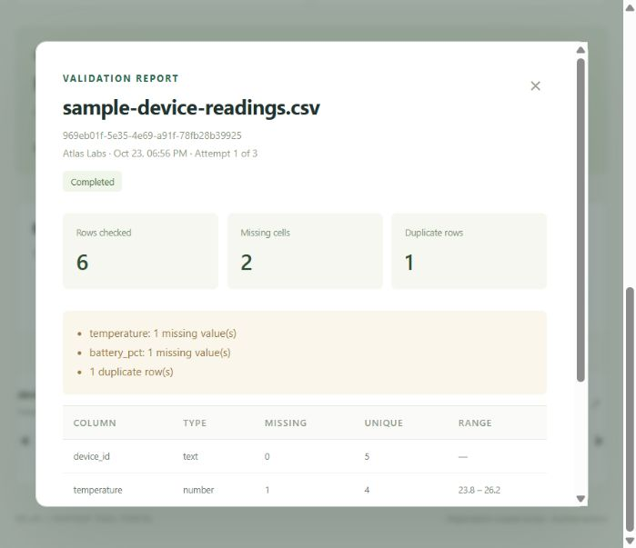
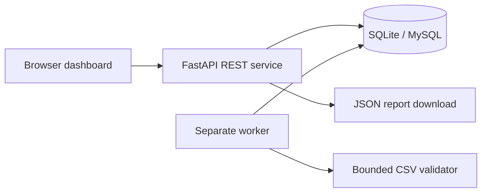

# Relay — Partner Tool Portal

A working infrastructure portfolio project that turns a CSV validation tool into a shared web service: sign in, submit a dataset, track an asynchronous job, and download a data quality report.

Built for demonstrating internal-tool productization, partner access boundaries, REST APIs, background processing, and operational practices. Uses synthetic sample data. This is independent work and contains no Meta code or integrations.



## What works

- Responsive dashboard, tool library, filename search, status filters, sample dataset, and JSON report downloads.
- Password sign-in with scrypt hashing, server-side sessions, HTTP-only cookies, request-origin checks, and failed-login throttling.
- Server-enforced roles: partners see their organization's jobs; internal engineers and administrators see all organizations. Audit logs are administrator-only.
- Separate durable worker process; atomic claims, 60-second leases, a maximum of 3 attempts, and stale-worker fencing.
- CSV shape validation plus missing-cell, duplicate-row, type and numeric-range checks.
- Cancellation, health endpoints, authenticated job-count metrics, and audit events.
- Raw CSV payloads are removed after completion, cancellation, or terminal failure.
- SQLite for local development; MySQL adapter and Docker Compose configuration; Kubernetes reference manifests; GitHub Actions checks.

## Run locally (Python 3.11+)

From this directory:

```powershell
python -m venv .venv
.\.venv\Scripts\python.exe -m pip install -r requirements.txt
.\.venv\Scripts\python.exe -m app.seed
.\.venv\Scripts\python.exe -m uvicorn app.main:app --host 127.0.0.1 --port 8000
```

In another terminal:

```powershell
.\.venv\Scripts\python.exe -m app.worker
```

Open **http://127.0.0.1:8000**. The explicit demo seed creates random passwords in **.local/demo-credentials.json**, which is ignored by Git. Seed only a disposable demo environment. Running it again does not change existing passwords.

On macOS/Linux use `.venv/bin/python` in place of the Windows executable path.

| Demo account | Access |
| --- | --- |
| admin@example.test | All jobs, metrics, audit log |
| engineer@example.test | All jobs and metrics |
| partner.a@example.test | Atlas Labs jobs |
| partner.b@example.test | Northstar Devices jobs |

Use the sample button or upload `sample.csv`. It deliberately contains **2 missing cells and 1 duplicate row across 6 rows**. Completed means the job ran successfully; its report can still flag data quality findings.

## Test

```sh
python -m unittest discover -s tests -v
node --check app/static/app.js
```

Tests start a real HTTP server on a random loopback port and use an isolated temporary SQLite database. They exercise authentication, session revocation, CSRF protection, tenant isolation, role boundaries, validation, report downloads, cancellation, competing workers, retries, lease recovery, and cancellation fencing.

## Docker Compose / MySQL

Requires a running Docker engine.

1. Copy `.env.example` to `.env` and replace both placeholder passwords with long random values.
2. Run `docker compose up --build -d`.
3. Run `docker compose exec api python -m app.seed`.
4. Read the disposable demo credentials with `docker compose exec api cat /data/demo-credentials.json`.
5. Open **http://localhost:8000**. Compose configures this exact origin; use localhost rather than 127.0.0.1 for this mode.
6. Stop with `docker compose down`. The named MySQL volume persists.

The demo credential file in the API container is not persistent; the accounts are in MySQL. Save your demo passwords before recreating the API container. Database reset procedures are intentionally not automated.

## Architecture



The database is the queue in this small project. A worker conditionally claims one job and assigns a unique worker token. Completion updates require that token, a live lease, and a running status. A cancelled job therefore cannot be overwritten by a late completion.

There is no Redis, object storage, or external model API to set up. See [architecture](docs/ARCHITECTURE.md), [operations](docs/RUNBOOK.md), [demo walkthrough](docs/DEMO.md), and [release checklist](docs/RELEASE.md).

## API

Machine-readable API schema: **/openapi.json**. For mutations include `X-Portal-Request: 1` and authenticate using the session cookie.

| Method | Route | Purpose |
| --- | --- | --- |
| POST | /api/login, /api/logout | Start/revoke a session |
| GET | /api/me | Current identity |
| GET, POST | /api/jobs | List scoped jobs / submit CSV JSON |
| GET | /api/jobs/{id} | Scoped job details |
| POST | /api/jobs/{id}/cancel | Cancel active job |
| GET | /api/jobs/{id}/report | Download completed report |
| GET | /api/audit | Administrator audit log |
| GET | /api/metrics | Internal job counts |
| GET | /health/live, /health/ready | Process / DB health |

Submission JSON: `{"filename":"example.csv","content":"x,y\n1,2\n"}`.

## Deployment boundaries

This is a tested local portfolio MVP, not an externally approved production service. Docker/MySQL and Kubernetes configuration are supplied but have not been executed in the authoring environment because the Docker engine was unavailable.

Before external use: integrate OIDC/SSO and managed user provisioning; terminate TLS and set `COOKIE_SECURE=1` and an exact `PORTAL_ORIGIN`; add ingress body/rate limits, organization quotas enforced transactionally, migrations, backups, retention, centralized logs/alerts, and security review. The Kubernetes file creates an internal service only and expects an existing MySQL service and a `portal-db-secret` containing `DB_PASSWORD`.

The dashboard lists the most recent 200 visible jobs; summary counts describe that window. Engineer/admin cross-organization access is an intentional policy. Audit entries cover user actions, not an immutable compliance trail. CSV type detection is heuristic; there is no schema policy engine, audio processing, or ML training.
